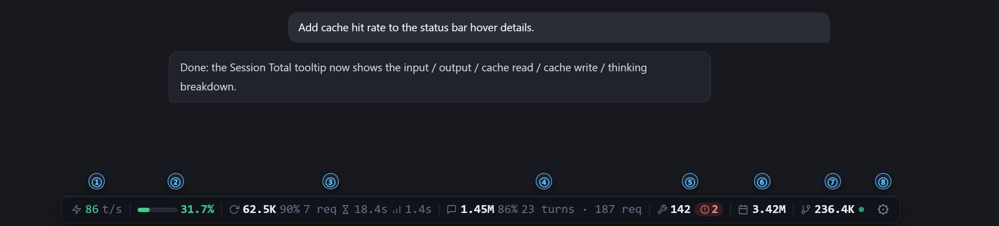
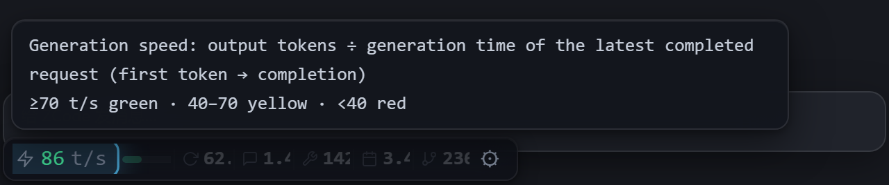
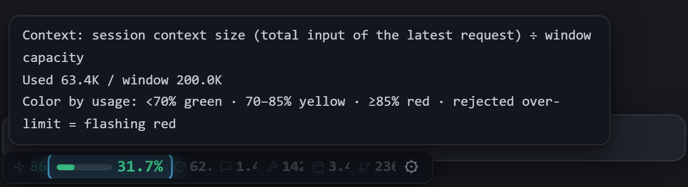
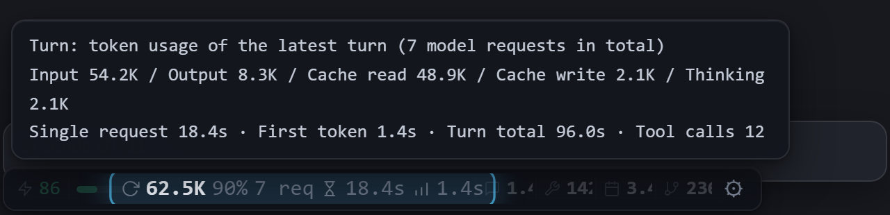
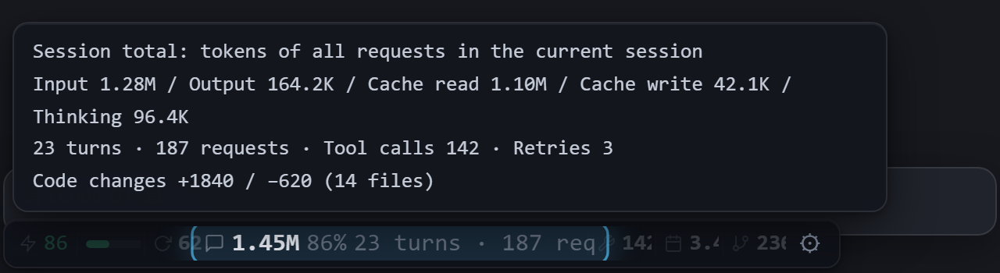
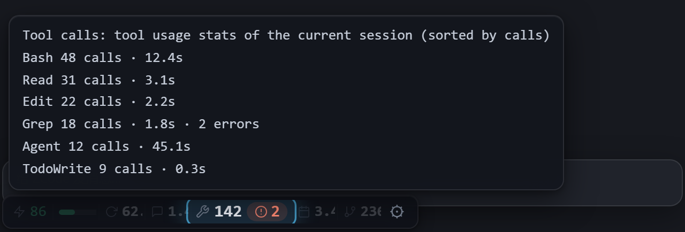
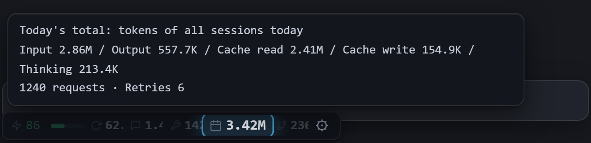
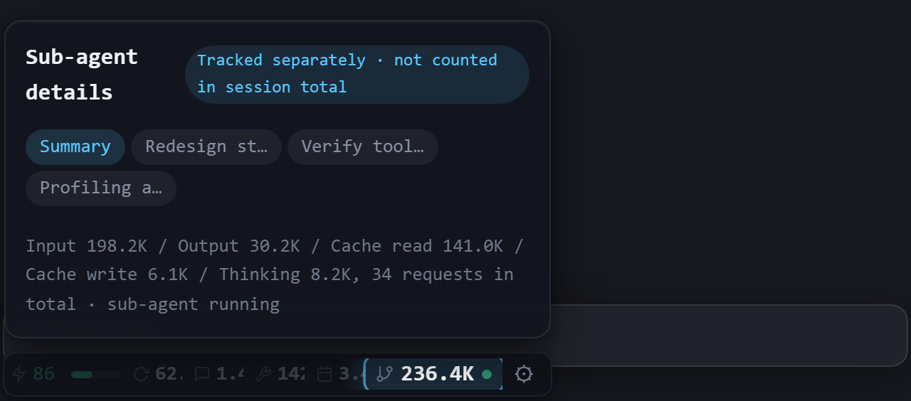
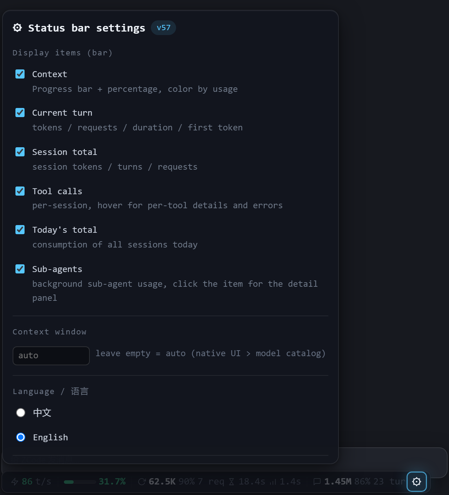

# ZCode Token Usage Status Bar

[中文](README.zh-CN.md) | English

A floating status bar for the [ZCode](https://zcode.ai) desktop client (Electron app) that shows real-time token usage of the current conversation window. Usage queries only read the local SQLite database and never use the network. Optional plugin updates fetch code through the configured marketplace without uploading usage data.

> This page is a condensed English overview. The in-depth docs in this repo are in Chinese.

> **Web edition for self-hosted deployments**: same data, same `zusage.py`, but delivered via
> nginx injection plus a read-only sidecar — works on both the direct web UI and the
> remote-control page. See [`web/`](web/README.md). The desktop and web editions are
> independent; install either or both.



## Features

The status bar floats at the bottom of the ZCode window and shows real-time token usage and runtime state of the current window. All items below can be toggled in the ⚙ panel.

### ① Generation Speed



Tokens per second of the most recent completed request (output tokens ÷ generation time, from first token to completion), color-coded in three tiers: ≥70 green, 40–70 yellow, <40 red — how fast the model is right now, at a glance.

### ② Context Capacity



A mini progress bar plus percentage showing how much of the context window the current session uses (total input of the latest request ÷ window capacity). The color shifts green → yellow → red as usage grows; large (≥1M tokens) windows warn earlier at 40%/60%. When a request is rejected for exceeding the window, the bar flashes red and a popup bubble offers three suggestions (roll back the previous turn / continue with a larger-window model or compress the session / start a new conversation). The window size is detected automatically: native ZCode UI (server-driven, follows the model) → built-in model catalog → `config.json` fallback — or override it manually in the ⚙ panel.

### ③ Current Turn



Token consumption of the latest turn, plus cache hit rate, model request count, single-request duration and first-token latency. Hover for the full breakdown: input / output / cache read / cache write / thinking, along with total turn duration and tool call count.

### ④ Session Total



Total consumption of all requests in the current session, with turn/request counts; code changes (+added / −removed lines and file count) are part of this item's details. Each conversation window shows only its own data — multiple windows never mix. Hover for the five-way breakdown.

### ⑤ Tool Calls



Total tool invocations in the session; a red badge lights up when errors occur. Hover for per-tool call counts, durations and error details.

### ⑥ Today's Total



Token consumption across all of today's sessions, aggregated across conversations and recalculated as each request completes.

### ⑦ Sub-agents



Token usage of background sub-agents in the current session, tracked separately from the session total; a blue ● means one is running right now. Hover shows a summary; clicking opens a fixed detail panel with tabs for the summary and each sub-agent's dispatch task name plus its input/output/cache/thinking breakdown.

### ⑧ Settings Panel



Click ⚙ to toggle any bar item, override the context window size, switch the UI language (中文 / English), or manage **automatic updates / manual checks / Update now** for the plugin installation. Hovering any bar item also shows a detail tooltip (view-only); interactive content — like sub-agent details — opens in click-triggered fixed panels instead.

### More

- **Automatic context-window detection**: native ZCode UI → model catalog → `config.json` fallback.
- **Session tracking**: each window shows only the data of its own focused session — zero cross-window bleed.
- **SSH remote sessions (v9)**: when the desktop client is connected to a remote zcode-server, session data lives in the remote machine's `~/.zcode/cli/db/db.sqlite`. Add a `remote` section to `config.json` and the bar **automatically switches to querying the remote host over SSH** when a remote conversation is focused — a ☁ "remote" badge appears (hover for host name / last error), and both session stats and the "today" total come from the remote database. The remote host only needs the same `zusage.py` deployed (its own config must NOT enable `remote`, to avoid recursion). Requires passwordless SSH (public-key auth) to the server — **or write `ssh` as an argv array** to borrow any channel that can run a command remotely, no public sshd needed: `["docker","exec","-i","<container>"]` for a zcode-server in a local Docker container, `["wsl","-d","<distro>"]`, `["kubectl","exec","-i","<pod>","--"]` (measured case: container sshd auth unavailable, `docker exec` reading the container's `db.sqlite` merged end-to-end). The pump polls at `remote.poll_ms` (default 3000) while a remote session is focused — local sessions remain purely event-driven. When a remote hit has all-zero items (the remote database has the session row but no completed requests), or when the session is missing locally with no `remote` configured, the bar says so in a badge instead of just showing a row of zeros.

  ```json
  "remote": {
    "enabled": true,
    "ssh": "ssh user@server",
    "script": "~/.zcode/zcode-token-usage-statusbar/zusage.py",
    "python": "python3",
    "timeout_s": 6,
    "poll_ms": 3000,
    "host_label": "my-server"
  }
  ```
- **MCP in-chat query**: `token_usage(scope)` supporting current / today / week / days:N / sessions:N / models:days / session:<id prefix> (with per-model and subagent details) / workspace:<dir keyword> (aggregates a workspace's main sessions + subagents, with per-session and per-model details; unmatched keywords return candidate directories).
- **CLI**: `python zusage.py [now|today|json|days N|sessions [N]|models [days]|workspace <dir keyword>|session <id prefix>|watch]`.
- **/usage command** in the chat input.

## Which edition do you want?

This repository ships **two independent editions** (Desktop / Web) plus a **plugin install
channel**. Installing the wrong one does not error — it simply does nothing — so check first:

| Your setup | Edition | Entry point | How to install |
|---|---|---|---|
| **ZCode desktop client** (the Electron app on Windows / macOS) | **Desktop** | `install.py` | `python install.py` at the repo root |
| **Self-hosted ZCode web** (your own server + nginx, opened in a browser or on a phone) | **Web** | [`web/`](web/README.md) | see `web/README.md` — do **not** run `install.py` |
| Want marketplace-managed install: query capability only (MCP tool, `/usage`, skill), with the floating bar as an optional extra | **Plugin** | `marketplace.json` + [`plugins/`](plugins/zcode-token-usage-statusbar/README.md) | see "Plugin channel" below |
| Both | Both | — | they are independent and can coexist |

**One-line test**: do you open ZCode as an **installed application**, or by typing a **URL in a browser**?

- The desktop edition injects a loader line into `app.asar`; it only affects the Electron client.
  Running it on a server has no effect at all.
- The web edition uses nginx injection plus a read-only sidecar; it only affects a web UI **you
  serve yourself**. There is no injection point on the official cloud pages.
- The plugin is managed by ZCode's plugin system (install / update / toggle) and **by default only
  reads the local usage DB for queries — it never touches the client**. When you want the floating
  bar, the plugin's built-in installer injects `app.asar` (command-triggered or hook-automated) —
  in essence the same injection line as the desktop edition.

## Plugin channel (query capability + optional overlay installer)

The MCP-query side is standard plugin territory, and it is packaged:
[`plugins/zcode-token-usage-statusbar/`](plugins/zcode-token-usage-statusbar/README.md) is a
standard ZCode plugin (marketplace manifest at the repo root) providing the `token_usage` MCP
tool, a `/usage` command and an auto-triggering skill — read-only access to the local usage DB.
From **1.2.0** it also appends a per-answer rate line at the end of every reply: on each prompt the
UserPromptSubmit hook records the question timestamp and instructs the model to run
`token_rate.py --turn --current` right before writing its final answer, then paste the printed line
as a Markdown quote at the very end of the reply. The line shows instant tok/s (numerator =
`output_tokens`, which **already includes thinking tokens** — the provider's native totalTokens is
input + output, so adding reasoning again would double-count; denominator = pure generation time
per segment, with thinking segments measured from request start since thinking tokens stream
before `first_token_at`; tool waits between segments excluded), weighted as total output ÷ total
generation time, first-token
latency, output tokens, generation time, segment count / peak rate (multi-segment turns only) and
the session cumulative total. The status bar's "generation speed" uses the same numerator and
denominator; the only difference is the object — the bar shows the instant speed of the latest
segment, the reply line shows the weighted average of the whole turn (hover the bar's speed item
for the full explanation). The `--current` guard compares the recorded question timestamp with
the rows the turn has in the DB: when the current question has no model requests in the database
yet — always true for pure Q&A turns at self-test time — the script prints nothing, so **a
previous turn's data is never shown as the current one** (pure Q&A replies intentionally carry no
stats line). From **1.3.0** the ⚙ settings panel has a toggle for it (**on by default**): turning
it off writes `answer_rate_line: false` into the runtime `config.json` and the hook reads that
file on every prompt, so it takes effect on the very next question without a restart
(query-only installs without the bar can edit that key directly; a missing or corrupt file means
on). With the floating bar installed, **hovering the rate line** at the end of a reply (cursor
turns to ?) pops a tooltip that explains every figure in detail — numerator/denominator of the
instant rate, TTFT, thinking-token semantics, segments/peak, session total, sampling time, and why
it differs from the bar's "generation speed" (the line itself is Markdown; the hover capability is
injected by the bar scanning the message stream).
It can also install the floating status bar on request
(`/zcode-token-usage-statusbar:install-overlay`, still an `app.asar` injection, client restart
required); the SessionStart hook nudges once by default and only auto-installs after you set
`"plugin_auto_install_overlay": true` in the runtime `config.json`.

Install the plugin (two ways; caveats in the [plugin README](plugins/zcode-token-usage-statusbar/README.md)):

```text
# Way 1: add from GitHub (recommended; requires the repo to be pushed)
/plugin marketplace add <owner>/zcode-token-usage-statusbar
/plugin install zcode-token-usage-statusbar@zusage-marketplace

# Way 2: local directory — clone this repo, then open
# Settings → Plugin → Discover → +, pick "Local directory", point it at the repo root
# (the level containing marketplace.json); or via command:
/plugin marketplace add /absolute/path/to/zcode-token-usage-statusbar
```

From plugin **1.1.0**, the overlay's **⚙ → Plugin updates** offers **Check for updates** (no install),
**Update now** (enabled when a newer version is found), and **Automatic updates** (on by default from **1.2.4**;
checks on first run, then checks and installs every 24 hours while ZCode is running). Missing settings use this default;
explicit `false` stays off, and invalid configuration does not enable automatic updates. The toggle persists as
`plugin_auto_update` in the runtime `config.json`. It uses ZCode's official plugin manager, keeps
existing settings and disabled-plugin choices, and reports failures, versions, check time and restart requirements.
Locally edited runtime files are preserved and listed.

From **1.4.0**, registered GitHub sources (including Git URLs hosted on GitHub) use **stable Release detection and download**, not development branch versions. The updater enumerates releases, excludes drafts, prereleases and screenshot tags, validates the manifest, ZIP and SHA256, then checks the official marketplace catalog points at exactly that asset before calling the official user-scope installer. Directory sources stay local and **do not run git pull**. Missing releases, mismatched catalogs and unsupported remote hosts are errors, never a fallback to branch code.

Maintainers must publish the generated Release catalog on the registered repository/ref; a dedicated `OWNER/REPO#plugin-releases` channel is recommended for new remote users. Existing registrations are never silently switched. Private repositories currently require an unsupported authenticated download flow and fail visibly rather than borrowing credentials..

The project-only [`zcode-github-release` skill](.zcode/skills/zcode-github-release/SKILL.md) prepares assets and a publishing preview using the repository's root scripts. It lives under `.zcode/skills/`, is not installed globally, and is not distributed with the plugin. Actual commits, tag pushes, Release publishing and catalog pushes require explicit authorization; creating the skill does not publish anything.

For the initial upgrade from 1.0.0, refresh `zusage-marketplace` in **Settings → Plugin Management**,
update the plugin to the latest version (currently **1.4.0**; automatic updates require **1.1.0+**), start a new session to synchronize runtime files, then restart ZCode once
(the updater adds main-process code). `/plugin marketplace update zusage-marketplace` is also
available for manual refresh. Source edits alone never update the installed cache.

### Recovery after a ZCode client upgrade (plugin 1.2.1+)

Client upgrades overwrite `app.asar`; user runtime files and installed plugins normally remain.
`plugin_auto_update: true` now allows SessionStart to run a detached update check even when the overlay
loader is absent. `plugin_auto_install_overlay: true` independently authorizes repairing a missing or
stale injection. Automatic updates default to on from 1.2.4; automatic reinjection still defaults to off.
Enabling updates never silently enables asar modifications or overrides an explicit disabled setting.

After automatic reinjection, **quit ZCode completely and start it once more** to load the repaired entry.
The hook does not restart the application. From 1.2.2, the next assistant reply starts with a quoted
restart reminder, repeated on later prompts until the loader actually loads. This uses hook context
and model compliance, not a native immediate notification. `.plugin-overlay-optout` prevents reinjection; a disabled
plugin, no SessionStart event, unwritable asar, or incompatible client packaging prevents recovery.
Targets use `ZCODE_ASAR`, saved `asar_path`, then verified platform candidates. Locked-file replacement
has a quiet finalizer that waits for client exit and cancels if another upgrade changes the asar.
Older installed plugins must first be updated to **1.2.1** through Plugin Management.

From **1.2.3**, updating the runtime loader (`inject-main.cjs`) or updater (`plugin-updater.cjs`)
also creates a restart reminder even when the existing injection is valid and no reinjection is needed.
The latest SessionStart diagnostic is saved as `plugin-session-start.json` in the runtime directory;
its `source` field distinguishes manual verification (for example, `manual-repair-check`) from a natural
SessionStart event. A successful manual check does not prove the hook fired naturally. See the
for evidence and remaining checks see the local deployment record (not shipped in this repo).

**1.3.1 reliability fixes:** separate OS locks serialize updates and runtime synchronization; trusted hashes preserve local edits on repeated same-version syncs. Installation intents reconcile committed versions after failures, and restart requirements persist across background processes until a matching loader startup acknowledges them. Automatic updates can be disabled while checking; an install already started will finish. Pending asar replacements validate generation-time source/TMP identities and retry transient locks; unverified legacy TMP files are not replaced automatically. Content changes with unchanged source mtimes still trigger hot reload. Restart after upgrading to retire old updaters that cannot honor the new locks. Windows finalization has isolated coverage, not an on-device validation..

Boundary to keep in mind: **installing the plugin alone gives you query capability, no floating
bar** — run the install command or the one-shot installer for that. Both drive the same runtime
directory and the same injection line, so they are interchangeable. Uninstalling the plugin does
not remove the bar; run `/zcode-token-usage-statusbar:uninstall-overlay` first.

## Installation (desktop edition)

> ⚠️ **This section is for the desktop edition (Windows / macOS client).** If you want the
> self-hosted **web** edition, see [`web/README.md`](web/README.md) — running `install.py`
> on a server does nothing, because it looks for an Electron client's `app.asar`.
>
> The **plugin channel** (see "Plugin channel" above) is an alternate entry to the same
> injection: the plugin manages query capability via the marketplace, and its built-in installer
> patches the same data directory and writes the same loader line — `install.py` and
> `/zcode-token-usage-statusbar:install-overlay` are interchangeable, and either can remove the
> other's injection.

Requirements: Windows or macOS; Python 3.8+ (zero third-party dependencies).

```bash
git clone https://github.com/xhwxt/zcode-token-usage-statusbar.git
cd zcode-token-usage-statusbar
python install.py            # add --lang en for English installer/CLI/MCP output
```

One command does it all: locate the ZCode installation (`ZCODE_ASAR` environment variable → common install locations → otherwise `--root` for the ZCode directory, e.g. `--root D:\Apps\ZCode`, or `--asar` for the full app.asar path; remembered after the first run) → copy the runtime into the data directory `~/.zcode/zcode-token-usage-statusbar/` → migrate/generate config.json → patch app.asar (a single loader line) → register the MCP server → install the /usage command → open an install-monitor window that reminds you to restart ZCode and confirms the injection took effect.

**ZCode upgrades overwrite app.asar and the injection must be redone** (an install-monitor
message like "injection not detected" usually means exactly this): re-run `python install.py`.
With the plugin installed and `"plugin_auto_install_overlay": true` set in the runtime
config.json, the SessionStart hook re-injects automatically on the next session — no manual step.

## Data Source

Reads `~/.zcode/cli/db/db.sqlite` (`model_usage` / `turn_usage` / `tool_usage` — one row per model request), strictly read-only, never online. Numbers refresh event-driven when a request completes; when idle there are zero extra processes and zero polling.

## Uninstall

### Desktop floating bar (installed by `install.py` or the plugin installer)

```bash
python install.py --remove
```

Uninstall does not rely on a backup: it only adds/removes this tool's own injection line inside app.asar, works while ZCode is running (effective after restart), leaves injections added later by other tools untouched, and never "restores" an officially upgraded asar back to an older snapshot.

### Plugin

In ZCode open **Settings → Plugin → Installed → ZCode Token Usage Statusbar → ⋯ → Uninstall**.
This removes **only the plugin itself**: it deregisters the `token_usage` MCP server, the commands,
the skill and the SessionStart hook, and deletes the cached copy under `~/.zcode/cli/plugins/cache/`.

#### Full removal checklist

GUI uninstall does **not** clear items 1, 3 and 4 below; everything must be gone for a clean
removal. **Step 1 must happen before uninstalling the plugin if done via the plugin command**
(the command is provided by the plugin):

| # | Residue | How to remove |
|---|---|---|
| 1 | Floating bar injection (app.asar) | Plugin still installed: run `/zcode-token-usage-statusbar:uninstall-overlay`; plugin already gone: from a repo clone run `python3 plugins/zcode-token-usage-statusbar/overlay_install.py remove` (or `python install.py --remove`). Then restart ZCode and confirm the bar is gone |
| 2 | Plugin itself | The GUI uninstall above (components and cached copy removed together) |
| 3 | Marketplace registration | Remove `zusage-marketplace` in Settings, and delete the clone directory `~/.zcode/cli/plugins/marketplaces/zusage-marketplace/` |
| 4 | Runtime directory | `rm -rf ~/.zcode/zcode-token-usage-statusbar/` (back up `config.json` first if you want your settings for a future reinstall) |

Self-check when done:

```bash
python3 patch_install.py check                       # expect: not injected
ls ~/.zcode/cli/plugins/cache                        # expect: no zusage-marketplace
ls ~/.zcode/zcode-token-usage-statusbar 2>/dev/null  # expect: gone
```

## Notes

- Accounting semantics: totals (`total` / 合计) = input + output as recorded by the client (`computed_total_tokens`); cache-read tokens are already **inside** input — don't add them again. Reasoning tokens are provider-reported only (e.g. DeepSeek reports them inside output; some GLM model ids never report them), so treat the reasoning split as informational.
- A session's usage is attributed to the workspace directory it currently belongs to; `model_usage` has no workspace dimension, so usage from before a session was moved to another workspace counts toward the new one. Subagent sessions carry the same directory as their parent — the `workspace:` scope groups them via `parent_id` to avoid double counting.
- Data semantics, performance measurements, diagnostics and pitfall notes (Chinese) live in [docs/design-notes.md](docs/design-notes.md).
- Patching app.asar is an unofficial injection route; ZCode updates overwrite it — re-run install after upgrading.
- Non-default install locations: pass `--root <ZCode directory>` (recommended — the platform's fixed `resources/app.asar` is appended) or `--asar <full app.asar path>`, or set the `ZCODE_ASAR` environment variable; the location is remembered after the first successful run.
- Auto-detection and the fallback scan only accept a target confirmed to be ZCode (a sibling `ZCode.exe`, or a package `name` containing zcode), so other Electron apps on the same machine (e.g. opencode) are never injected (added with the issue #6 fix).
- macOS support was added in v60 (issue #2). Windows is the fully tested platform; the author has no macOS device, so macOS is untested — issues and feedback are welcome.
- License: [MIT](LICENSE).
