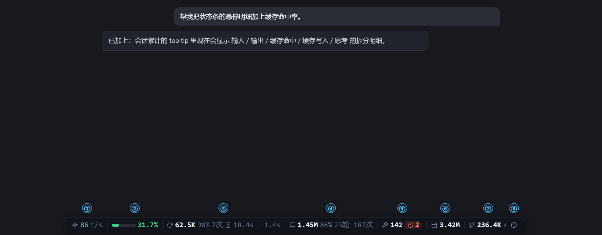
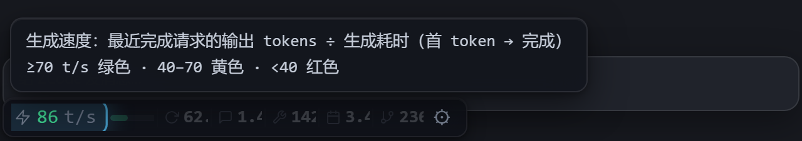
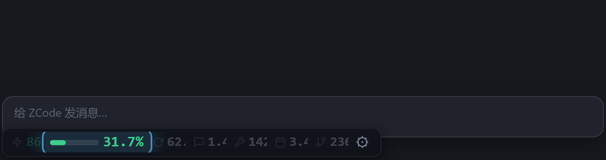
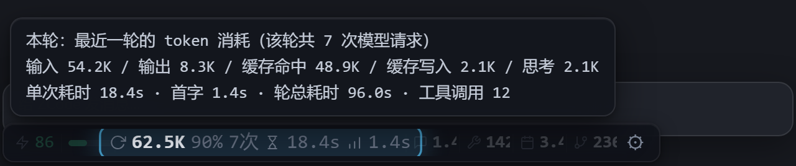
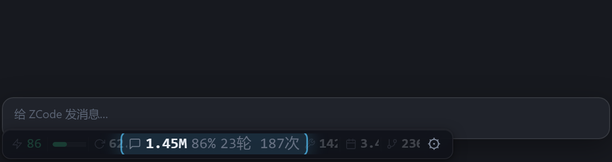
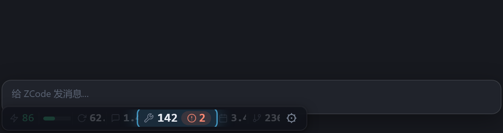
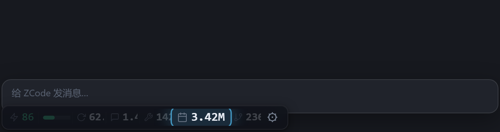
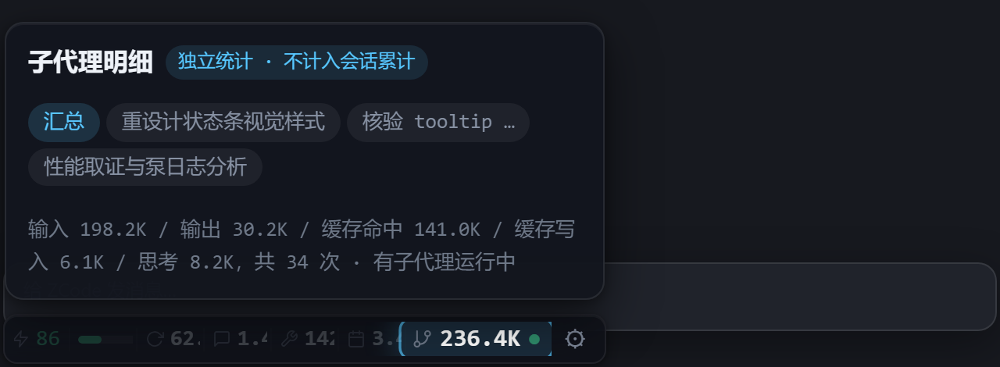
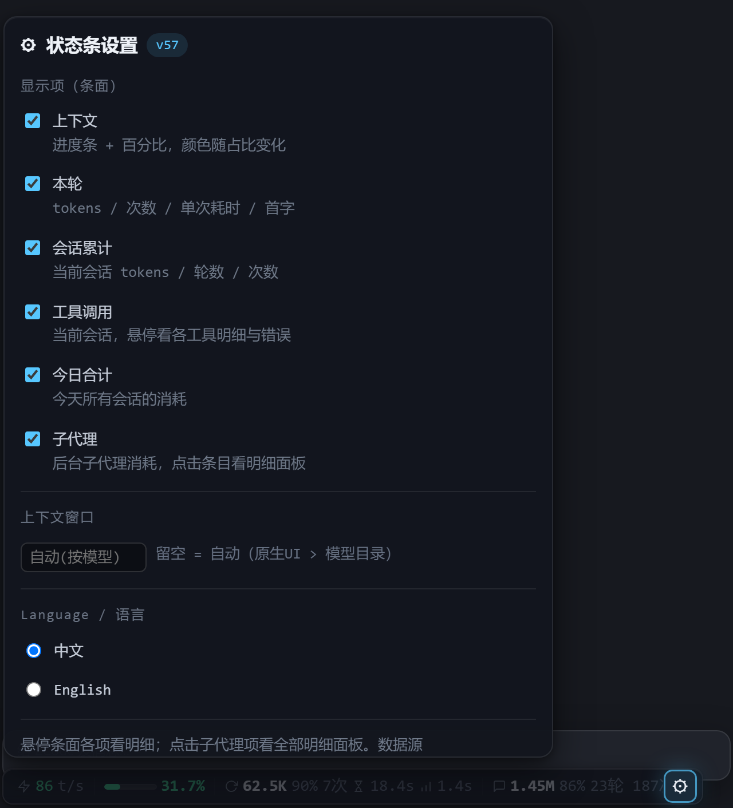

# ZCode Token 用量状态栏

[English](README.md) | 简体中文

给 [ZCode](https://zcode.ai) 桌面客户端（Electron 应用）加上一个悬浮的 token 用量状态条。数据源是本地 SQLite（`~/.zcode/cli/db/db.sqlite` 的 `model_usage` / `turn_usage` / `tool_usage` 表，每次模型请求一行），**用量查询全程只读、不联网**。插件更新仅通过已配置的市场获取代码，不上传用量数据。

平台：Windows、macOS ｜ 许可：[MIT](LICENSE)

## 先选版本：你是哪一种用户？

本仓库有**两个互不依赖的版本**（桌面版 / 网页版）和一种**插件安装形态**，装错了不会报错，只会「什么都没发生」——所以先对一下：

| 你的情况 | 装哪个 | 入口 | 装法 |
|---|---|---|---|
| 用 **ZCode 桌面客户端**（Windows / macOS 的 Electron 应用） | **桌面版** | `install.py` | 根目录 `python install.py` |
| 用**自托管 ZCode 的网页**（自己跑的 server + nginx，浏览器/手机访问） | **网页版** | [`web/`](web/README.zh-CN.md) | 见 web/ 的 README，**不要**跑 `install.py` |
| 想走 **ZCode 插件市场**安装：只要查询能力（MCP 工具、`/usage`、技能），或之后用插件里的安装器装浮层 | **插件** | `marketplace.json` + [`plugins/`](plugins/zcode-token-usage-statusbar/README.md) | 见下方「插件方式」一节 |
| 两个都用 | 两个都装 | — | 互不干扰，可共存 |

**一句话判断**：你打开 ZCode 是用一个**装好的应用程序**，还是在**浏览器里输网址**？

- 桌面版往 `app.asar` 注入一行 loader，**只对 Electron 客户端有效**；在服务器上跑它不会有任何效果。
- 网页版靠 nginx 注入 + 一个只读旁挂服务，**只对你自己伺服的网页有效**；官方云端的页面没有注入点。
- 插件由 ZCode 插件体系统一管理（安装/更新/启停），**默认只读本地 usage 数据库做查询、不改客户端**；
  需要悬浮条时再用插件内置的安装器注入 `app.asar`（命令触发或 hook 自动），本质上和桌面版是同一行注入。

> 文档与界面统一使用中文名「ZCode Token 用量状态栏」；仓库与 MCP 注册名为 `zcode-token-usage-statusbar`（全称的英文写法），代码内部标识符为 `zusage`。

## 为什么是注入而不是插件？

ZCode 的插件机制只有五种组件——skills / commands / agents / hooks / MCP——**没有任何客户端 UI 能力**（`channels`、`lspServers`、`outputStyles`、`settings` 等字段仅登记、不执行）；状态条要画进主窗口，唯一路线还是往 `app.asar` 主入口注入一行 loader。查询部分则是标准的插件级能力，本仓库已把它连同浮层安装器一起打包成插件（见下一节）：插件里的安装命令和 SessionStart hook **替你执行注入**，但那仍是「插件运行安装器」，不是插件系统提供了 UI 能力。

（网页版的处境一样：插件清单只能贡献 skill / command / agent / hook / mcp 五种组件，官方
`CONTEXT.md` 写明、协议层也是封闭枚举。区别是网页版没有 asar，所以改在 nginx 层注入。）

## 插件方式：查询能力 + 可选的浮层安装器

上面说的「插件级能力」已经打包好了：[`plugins/zcode-token-usage-statusbar/`](plugins/zcode-token-usage-statusbar/README.md)
是标准 ZCode 插件（仓库根带 `marketplace.json`），提供：

- **查询三件套**：`token_usage` MCP 工具、`/usage` 命令、自动触发技能——只读本地 usage 数据库；
- **可选浮层安装器**：`/zcode-token-usage-statusbar:install-overlay` 显式安装悬浮状态条
  （仍是注入 `app.asar`，重启客户端生效）；SessionStart hook 默认只提示一次，
  在运行时目录 `config.json` 写 `"plugin_auto_install_overlay": true` 后才自动安装/更新。
- **逐问速率行（1.2.0）**：每次提问经 UserPromptSubmit hook 记录提问时刻，模型在回答收尾时运行
  `token_rate.py --turn --current` 自测本问速率，把统计行以 Markdown 引用块附在回复末尾——
  即时 tok/s、首字延迟、输出 token 数、生成耗时、段数/峰值（多段轮次才显示）与会话累计。
  口径（2026-10-14 裁决）：分子 = `output_tokens`（**该列已含思考 token**，provider 原生
  totalTokens = input + output 不另加）；分母只计纯生成时长，**含思考段从请求开始计**
  （思考 token 在 first_token_at 之前流出），段间工具等待不计入。与状态条「生成速度」同口径，
  区别只在对象：状态条 = 最近一段的瞬时速度，统计行 = 本问全部段的加权均值（悬停状态条
  速率项可见两者差异的完整解释）。`--current` 守卫把状态文件里的提问时刻与
  本轮入库数据比对：本问尚无任何模型请求（纯问答轮收尾自测时必然如此）就输出为空，
  **绝不把上一轮数据当作本问显示**；因此纯问答回复有意不带统计行。
  **⚙ 设置面板有开关（1.3.0，默认开启）**：关闭后写入运行时 `config.json` 的
  `answer_rate_line: false`，下一问即停用（无需重启）；查询版没装浮层时可直接改该键。
  装了浮层的客户端里**悬停统计行**（指针变 ? 形）会弹出逐数值口径详解的 tooltip
  （含与状态条「生成速度」为何不同）。

安装插件（两种方式，注意事项见[插件 README](plugins/zcode-token-usage-statusbar/README.md)）：

```text
# 方式一：从 GitHub 添加（推荐；需仓库已推送）
/plugin marketplace add <owner>/zcode-token-usage-statusbar
/plugin install zcode-token-usage-statusbar@zusage-marketplace

# 方式二：本地目录 —— 克隆本仓库后，在 ZCode 中打开
# 设置 → 插件管理 → 发现 → +，来源选「本地目录」，指向仓库根目录（含 marketplace.json）；
# 或直接用命令：
/plugin marketplace add /绝对路径/到/zcode-token-usage-statusbar
```

更新（插件 1.1.0 起）：浮层的 **⚙ 设置 → 插件更新** 提供：

- **检查更新**：按已注册来源检测版本，不安装；显示当前/可用版本、来源与上次检测时间。
- **立即更新**：发现新版后可用，交给 ZCode 官方插件管理器安装，再同步稳定运行目录。
- **自动更新**：**1.2.4 起默认开启**；未填写配置时开启，已有显式 `false` 保持关闭；首次运行检查，之后客户端运行时每 24 小时检测并安装新版，手动开启时立即按限频规则检查。
  开关保存到运行时 `config.json` 的 `plugin_auto_update`，不会改动其它配置或自动启用已禁用的插件。
- 网络/市场错误会显示失败原因，可以手动重试；主进程文件更新提示重启 ZCode，插件组件更新后需重开会话。
  本地手改热修会保留并列出未覆盖文件。

**1.4.0 起，更新来源跟随已注册的市场**：GitHub 来源及托管在 GitHub 的 Git 来源走 **正式 Release 检测与下载**，不按开发分支版本更新。枚举 Release 并排除 draft、预发布和截图 tag；更新时校验 manifest、ZIP、SHA256 与安全解包，再核对官方市场清单指向完全相同的 ZIP/hash，最后由官方安装器按原插件 ID 安装。本地目录仍只刷新本地文件，**不会替你 git pull**。

维护者须将生成的 Release 渠道清单发布到用户注册的同仓库/ref；新远端用户建议注册 `OWNER/REPO#plugin-releases`。已有注册不会自动切换。没有正式包、清单不一致或非 GitHub 远端会明确报错，不回退开发分支；私有仓库暂不支持认证下载，不会借用凭据。

项目专用技能 [`zcode-github-release`](.zcode/skills/zcode-github-release/SKILL.md) 可触发检查、确定性打包、发布预演和正式发布流程。技能仅放在本项目 `.zcode/skills/`，直接调用仓库根脚本，不全局安装，也不随插件分发。提交、tag 推送、Release 和渠道清单推送均须明确授权，创建技能不等于已经发布。

首次从 1.0.0 升级：在 **设置 → 插件管理** 刷新 `zusage-marketplace`，更新本插件到最新版本（当前 **1.4.0**，自动更新要求 **1.1.0+**），
重开会话让 hook 同步文件，再重启 ZCode 一次（此次新增主进程更新器）。
也可手动执行 `/plugin marketplace update zusage-marketplace` 后从插件管理页更新；
仓库改动不会直接进入 `~/.zcode/cli/plugins/cache/` 的已安装副本。

### ZCode 客户端升级后的恢复（插件 1.2.1 起）

ZCode 升级会覆盖 `app.asar`，但用户运行目录、插件配置和缓存通常保留。两种自动行为互相独立：

| 配置开关 | 升级后行为 |
|---|---|
| `plugin_auto_update: true` | 新建/恢复会话时，SessionStart 在后台独立检查插件更新；即使浮层 loader 尚未恢复，也可运行。不等于授权修改 asar。浮层加载后仍按 24 小时周期检查。 |
| `plugin_auto_install_overlay: true` | SessionStart 检查当前客户端注入，缺失或指向旧目录时重新安装；成功后需**完全退出再启动 ZCode 一次**，当前进程不会因修改 asar 自动加载 loader。 |

自动更新默认开启，自动恢复浮层仍默认关闭；要同时启用，可在运行时 `config.json` 设置两项为 `true`。显式关闭自动更新的选择不会被覆盖；损坏配置或非布尔值不会启动自动更新。
`.plugin-overlay-optout` 会阻止自动重注入；插件被禁用、会话 hook 未触发、asar 不可写、SDK 入口变化或完整性校验收紧时，无法保证自动恢复。

安装位置按 `ZCODE_ASAR` → 保存的 `asar_path` → 当前平台常见位置探测，生产候选必须确认是 ZCode。
Windows 正在运行导致替换失败时，使用无窗口收尾进程等待退出；若等待期间客户端再次升级，取消旧 TMP 替换，防止覆盖新版。
1.2.2 起，重新注入成功后的下一条助手回复顶部会给出引用块提醒，未重启时后续提问会继续携带提醒；只有主进程实际加载 loader 才清除。位置不依赖尚未恢复的状态条。提醒由插件上下文要求模型展示，不是客户端原生即时通知。
不会自行重启客户端。旧版插件须先通过插件管理页升级到 **1.2.2** 才含首次重启提醒，只修改本仓库不会让 1.0.0 缓存获得修复。

**1.2.3 起**，运行时 loader（`inject-main.cjs`）或 updater（`plugin-updater.cjs`）更新时，即使现有注入有效、无需再次注入，也会生成重启提醒。
SessionStart 最近一次诊断保存在运行时目录的 `plugin-session-start.json`；`source` 字段可区分手动验证（如 `manual-repair-check`）与自然 SessionStart 事件，手动执行成功不等于自然触发已验证。

**1.3.1 更新可靠性修复**：更新与运行时同步使用独立的操作系统锁，避免并发回滚；可信 hash 基线持续保护热修，同版同步也不会覆盖手改。安装提交后错误会协调实际安装记录，后台更新的重启需求持久保存，loader 仅确认已加载的文件指纹。检查期间可关闭自动更新，已经开始的安装不会取消；待替换 asar 校验生成时来源与 TMP 身份，短暂占用会重试，未知历史 TMP 不自动替换。相同源 mtime 的内容升级也会触发热更新。旧更新器无法遵守新锁，升级此版后须完全退出并启动一次；Windows 收尾分支有隔离回归，尚未实机验证。

注意分界：**装插件只有查询能力，没有浮层**——浮层要么跑安装命令、要么继续用一键安装器；
两者操作的是同一个运行时目录和同一行注入，可互相替换。插件卸载不会自动卸载浮层，
请先跑 `/zcode-token-usage-statusbar:uninstall-overlay`。

## 功能

状态条悬浮在 ZCode 对话窗口最底部，实时显示本窗口的 token 用量与运行状态——数据只读本地数据库（每次模型请求一行），全程不联网、零轮询。



### ① 生成速度



条面第一项显示最近一次完成请求的生成速度（输出 tokens ÷ 生成耗时，从首 token 到完成），按快慢三档变色：≥70 绿、40–70 黄、<40 红——当前模型快不快，一眼可读。每次请求完成落库后自动刷新。

### ② 上下文容量



微进度条 + 百分比显示当前会话的上下文占比（最近一次请求的总输入 ÷ 上下文窗口容量），颜色随占比从绿转黄再转红；百万级大窗口提前预警（40%/60% 档），其余窗口 70%/85% 档。请求因超出窗口容量被拒绝时，进度条亮红闪烁并弹出告警气泡，给出三条处置建议（回滚上一轮对话 / 换用上下文窗口更大的模型继续，或压缩精简本会话 / 新开会话）。窗口大小无需手动配置：优先读 ZCode 原生 UI（服务端下发、自动跟随模型）→ 模型目录查表 → `config.json` 兜底，也可以在 ⚙ 设置里手动覆盖。

### ③ 本轮



显示最近一轮对话（从你发消息到本轮完成）的 token 消耗、缓存命中率、模型请求次数、单次请求耗时与首字延迟。悬停可看完整拆分：输入 / 输出 / 缓存命中 / 缓存写入 / 思考，以及轮总耗时与工具调用次数。

### ④ 会话累计



当前会话全部请求的总消耗与轮次、请求次数统计；代码变更（+新增 / -删除行数与涉及文件数）也在这一项的明细里。每个对话窗口只显示它自己的数据（泵按窗口注入焦点会话），多窗口互不串显；悬停同样有 输入 / 输出 / 缓存命中 / 缓存写入 / 思考 的五项拆分。

### ⑤ 工具调用



当前会话的工具使用总次数；出现错误时右侧亮红色错误数徽标，工具是否稳定一目了然。悬停可看各工具的调用次数、耗时与错误明细。

### ⑥ 今日合计



今天所有会话的 token 总消耗，跨会话汇总、随每次请求完成实时重算，日用量一目了然。

### ⑦ 子代理



当前会话后台子代理的 token 消耗，独立统计、不计入会话累计；蓝色 ● 表示有子代理正在运行。悬停显示汇总，点击弹出固定明细面板——按页签切换汇总与各子代理，每个子代理显示派发任务名与输入/输出/缓存/思考明细。

### ⑧ 设置面板



点击 ⚙ 打开设置：各显示项独立开关、上下文窗口大小手动覆盖、界面语言切换（中文 / English，即时生效并记住选择），以及插件方式的**自动更新 / 检查更新 / 立即更新**（见上方更新说明）。悬停条面任意条目都会弹出明细 tooltip（纯查看，v67.1 起为「粗体标签 + 解释」结构化排版，与回复末尾统计行的悬停解释同款），需要操作的内容（如子代理明细）则用点击弹出的固定面板，互不打架。

### 其它能力

- **上下文窗口自动识别**：优先读 ZCode 原生 UI（输入框工具行按钮文本"…总量 N"，服务端下发、自动跟随模型）→ 模型目录查表 → `config.json` 兜底。
- **会话跟随**：泵按窗口注入本窗口焦点会话 id（渲染端经客户端 IPC 通道上报），每个对话窗口只显示它自己的数据，池里没有就显示零值、绝不串显别的会话。
- **SSH 远程会话支持（v9）**：桌面客户端连远端 zcode-server 时，会话数据落在远端机的 `~/.zcode/cli/db/db.sqlite`，本地库查不到。配置 `config.json` 的 `remote` 段后，切换到远端对话会**自动改为 SSH 到远端机查询**：条面出现 ☁「远端」徽标（悬停显示主机名与最近错误），会话数据与「今日合计」均为远端值。远端机只需部署同一份 `zusage.py`（保持其 config 不含 remote 段即可，防递归）：

  ```json
  "remote": {
    "enabled": true,
    "ssh": "ssh 用户名@服务器地址",
    "script": "~/.zcode/zcode-token-usage-statusbar/zusage.py",
    "python": "python3",
    "timeout_s": 6,
    "poll_ms": 3000,
    "host_label": "我的服务器"
  }
  ```

  前提：本地到服务器的 `ssh` 免密可用（公钥认证）。**`ssh` 也可以写成数组（argv 形式）**——凡是能在远端执行命令的通道都能借道，不必有公网 sshd 与公钥免密：跑在本地 Docker 容器里的 zcode-server 用 `["docker","exec","-i","<容器名>"]`、WSL 用 `["wsl","-d","<发行版>"]`、k8s 用 `["kubectl","exec","-i","<pod>","--"]` 都可以（实测场景：容器 sshd 认证不通，`docker exec` 直读容器内 `db.sqlite`，端到端合并正常）。实现上，本地 `zusage.py` 对本地库查不到的会话 id（双重白名单校验）执行 `ssh <host> python3 <script> json <sids>`，把远端快照合并进 payload；远端返回 `known_sids` 供负缓存（确认无此会话 2 分钟内不重问，ssh 失败 60 秒退避），本地新会话（session 表已有行）不会触发远端查询。泵在远端会话聚焦期间按 `poll_ms` 轮询（本地会话仍是纯事件触发、零轮询）；`poll_ms` 别低于 1000，跨公网建议配合 ssh ControlMaster 连接复用。远端命中但各项为 0（远端库有该会话、却没有已完成的请求）与「本地库没有这个会话、又没配 remote」两种情形，条面徽标会写明原因，不再只显示一排 0。
- **MCP 对话内查询**：`token_usage(scope)` 工具，scope 支持 current / today / week / days:N / sessions:N / models:days / session:<id前缀>（含按模型与子代理明细）/ workspace:<目录关键词>（按工作区聚合主会话+子代理，含按会话与按模型明细；关键词未命中时会列出候选目录）。
- **CLI**：`python zusage.py [now|today|json|days N|sessions [N]|models [days]|workspace <目录关键词>|session <id前缀>|watch [秒]]`。
- **/usage 命令**：对话输入框触发 MCP 查询。

## 文件说明

| 文件 | 作用 |
|---|---|
| `install.py` | **一键安装**：探测 ZCode 安装位置 → 复制运行时到数据目录 → 生成 config → 注入 asar → 注册 MCP → 装 /usage 命令 → 弹监控窗口。`--remove` 卸载，`--dry-run` 预览，`--no-mcp` 只装状态条，`--dev` 开发模式（不复制，注入直指本仓库目录）。 |
| `overlay.js` | 状态条本体（渲染进程注入，自包含 IIFE）。fixed 悬浮在**窗口最底部**（条下只留 3px 缝，给输入卡片加 margin-bottom 上移让位），rAF 每帧跟随；输入框定位要求 textarea 在视口下半部（排除设置页等处的输入元素）。 |
| `inject-main.cjs` | 主进程 loader：向每个窗口注入 overlay.js + **触发式监听 db 写入**（fs.watch db 目录，有写入→去抖 300ms→查询推送；空闲零进程零轮询，仅 30s 兜底心跳）。查询走**常驻 python**（`zusage.py serve` 行协议；意外退出自动重启、30s 内 3 次判不稳定回退一次性 spawn、zusage.py mtime 变化自动重启；stdin EOF 随泵退出自清理）。 |
| `patch_install.py` | asar 注入/卸载工具（install.py 的底层，可单独用）：在入口 `out/main/index.js` 尾部追加/剥离本工具的 dynamic import 行 → 重打包 → 自检 → 原子替换。不制作也不依赖备份，卸载只动自己的注入行（其它工具后装的注入行不受影响）。幂等，自动替换旧注入行（迁移友好）。安装成功自动弹出监控窗口。 |
| `install_monitor.py` | 安装监控窗口（常驻命令行，每 10 秒检测一次）：持续提醒重启 ZCode；重启后通过 diag 更新确认注入加载，显示成功并自动退出。运行中原子替换失败（生成 .tmp）时，它还会在 ZCode 退出后自动完成替换——**收尾不依赖计划任务**。 |
| `plugin-updater.cjs` | 桌面插件更新器：调用 ZCode 自带插件管理 CLI 检测/安装；自动开关及 24 小时限频持久化，失败和重启状态推送设置面板。 |
| `zusage.py` | 查询库 + CLI + 机器可读快照（`json` 子命令，状态条数据源）。 |
| `usage_mcp.py` | 零依赖 stdio MCP server。 |
| `config.example.json` | 运行配置模板（安装时生成到数据目录的 `config.json`；含本机路径，不入库）。 |
| `marketplace.json` | 插件市场清单（ZCode 插件市场的仓库入口，`plugins[].source` 指向 `plugins/` 子目录）。设置 → 插件管理添加本仓库或 `/plugin marketplace add` 时读取。 |
| `sync_plugin.py` | 插件打包副本同步器：把根目录 7 个运行时文件同步进 `plugins/zcode-token-usage-statusbar/`（副本随插件分发；改根文件后跑一次，`--check` 供 CI 查漂移）。 |
| `plugins/zcode-token-usage-statusbar/` | 插件包：清单（`.zcode-plugin/`，附 `.claude-plugin/` 兼容副本）、`.mcp.json`（`token_usage` MCP 工具）、`commands/`（/usage 与浮层安装/卸载）、`skills/`、`hooks/`（SessionStart 自动同步/自动安装；UserPromptSubmit 记录提问时刻并下达「本问统计」指令）、`token_rate.py`（逐问速率 CLI，`--turn --current` 守卫）、`overlay_install.py`（浮层安装器）及 7 个运行时文件副本。详见其 [README](plugins/zcode-token-usage-statusbar/README.md)。 |

**数据目录 `~/.zcode/zcode-token-usage-statusbar/`** 是标准安装的运行目录：运行时副本（`inject-main.cjs`/`overlay.js`/`zusage.py`/`usage_mcp.py`）、`config.json`、诊断产物 `diag-<n>.json`（每窗口一份，主进程定期回写）都在这里。本仓库只是源码，**clone 目录可以随意搬走或删除，不影响已安装的实例**。

## 安装（桌面版）

> ⚠️ **这一节是桌面版（Windows / macOS 客户端）。** 如果你要装的是自托管网页版，
> 请看 [`web/README.zh-CN.md`](web/README.zh-CN.md) —— 在服务器上跑下面的 `install.py` **不会有效果**，
> 它找的是 Electron 客户端的 `app.asar`。
>
> 也可以走**插件方式**（见下方「插件方式」一节）：查询能力由插件市场管理，浮层用插件内置安装器注入。
> 两条路操作的是**同一个数据目录、同一行注入**，可互换——本节的 `install.py` 与插件的
> `/zcode-token-usage-statusbar:install-overlay` 谁装都一样，卸载也都认得对方写的注入行。

前提：Windows 或 macOS；Python 3.8+（零第三方依赖）；fuses `EmbeddedAsarIntegrityValidation=0`（ZCode 当前版本实测为 0）。

```bash
git clone https://github.com/xhwxt/zcode-token-usage-statusbar.git
cd zcode-token-usage-statusbar
python install.py            # 加 --lang en 可让安装器/CLI/MCP 输出英文
```

一条命令完成：探测 ZCode 安装位置（环境变量 `ZCODE_ASAR` → 常见目录 → 找不到时询问，或 `--root` 指定 ZCode 安装目录 / `--asar` 指定 app.asar 完整路径；首次成功后记住位置，之后一律免传）→ **复制运行时到数据目录 `~/.zcode/zcode-token-usage-statusbar/`** → 迁移/生成 config.json → 注入 asar（注入行指向数据目录副本）→ 注册 MCP（server 名 `zcode-token-usage-statusbar`，指向数据目录副本）→ 安装 /usage 命令 → 弹出「安装监控」窗口（每 10 秒检测一次，提醒重启 ZCode；重启后检测到注入加载即显示成功并自动关闭；万一运行中原子替换失败，监控窗口会在你退出 ZCode 后自动完成替换）。

**ZCode 升级会覆盖 app.asar，注入需重做**（监控窗口提示“未检测到注入加载”通常就是这个原因）：重跑一次 `python install.py` 即可；若装了插件且运行时 config.json 开了 `"plugin_auto_install_overlay": true`，新建/恢复会话的 SessionStart hook 会重新注入，完成后仍需完全退出并再次启动客户端。插件 1.2.1 起，开启 `plugin_auto_update` 后，即使 loader 尚未恢复也可由 SessionStart 独立检查插件更新。

<details>
<summary>手动分步安装（等价于 install.py 做的事）</summary>

```bash
# 0) 数据目录：复制运行时 + 配置（改 python_path 为你的 python.exe 绝对路径）
mkdir -p ~/.zcode/zcode-token-usage-statusbar
cp inject-main.cjs overlay.js zusage.py usage_mcp.py ~/.zcode/zcode-token-usage-statusbar/
cp config.example.json ~/.zcode/zcode-token-usage-statusbar/config.json   # 然后编辑它

# 1) 状态条：注入 asar（注入行须指向数据目录的 inject-main.cjs；ZCode 运行中也可执行；
#    ZCode 不在脚本默认位置时先改脚本顶部 ASAR，或直接用 install.py）
python patch_install.py install

# 2) MCP：在 ~/.zcode/cli/config.json 的 mcp.servers 注册（指向数据目录副本）：
#   "zcode-token-usage-statusbar": { "command": "<python 绝对路径>", "args": ["<home>/.zcode/zcode-token-usage-statusbar/usage_mcp.py"] }

# 3) /usage 命令：把 usage.command.md 复制到 ~/.zcode/commands/usage.md
```

</details>

## 更新规则（重要）

改的是**仓库源码**，生效分两步：`git pull` 后重跑 `python install.py` 同步到数据目录副本，再按下表生效（注入行不变时 asar 不重打包，重跑是秒级）：

| 改了什么 | 生效方式 |
|---|---|
| `overlay.js` | 重跑 install.py 同步副本后，`hot_reload` 开着时 ~2 秒热更新，免重启（loader 检测副本 mtime，`new Function` 语法校验通过才注入，防载入写一半的文件）；`hot_reload: false` 关闭后改完需重启 |
| `zusage.py` | 重跑 install.py 同步副本后，泵检测到副本 mtime 变化即自动重启常驻 python（~2 秒生效）；一次性回退模式下仍是每次轮询新进程、下次轮询生效 |
| `config.json`（数据目录） | 下次拉取时生效（拉取由 db 写入触发；完全空闲时最迟一个兜底心跳，默认 30s） |
| `inject-main.cjs` 本身 / 首次安装 / 标准↔dev 互切 | 重跑 `python install.py` 后**需重启 ZCode**（注入行含绝对路径，脚本自动替换旧行） |

## 配置（config.json）

位置：标准安装在数据目录 `~/.zcode/zcode-token-usage-statusbar/config.json`（`--dev` 安装在仓库目录）。

```json
{
  "python_path": "python.exe 绝对路径",
  "activity_min_ms": 1500,  // 有 db 写入时的最小拉取间隔（活动期限频，到点自动补拉最后一笔）
  "heartbeat_ms": 30000,    // 兜底心跳：防 fs.watch 文件事件丢失；空闲时拉取只由此触发
  "resident": true,         // 常驻查询 python（zusage.py serve，省每次启动费 ~17MB 常驻内存）；false=回退一次性短进程
  "hot_reload": true,       // overlay.js 热更新开关（调试用）；false=改完需重启 ZCode
  "answer_rate_line": true, // 逐问速率行（⚙ 面板可切换，默认开）；false=下一问起不再追加统计行
  "plugin_auto_update": true, // 插件自动更新（⚙ 面板可切换），1.2.4 起默认开，显式 false 保持关闭，24 小时检测一次
  "plugin_auto_install_overlay": false, // 客户端升级后自动重注入，默认关；成功后仍需再重启一次
  "context_window": 1000000 // 上下文兜底值（原生读数/模型目录都失败时用）
}
```

## 数据口径、性能与排查

各数字的统计口径、性能实测数据、诊断手段（diag）与踩坑记录，见 **[docs/design-notes.md](docs/design-notes.md)**。

## 已知限制

- 口径说明：合计 = input + output（客户端 `computed_total_tokens` 原值），缓存读已含在 input 内、不要重复相加；reasoning（模型推理/思维链 token）仅部分提供方上报（DeepSeek 系上报且含在 output 内，部分 GLM 模型 id 恒不上报），推理拆分仅供参考。
- 会话的用量归属其当前所在工作区目录（model_usage 无工作区维度），会话迁移过工作区的话历史用量一并算进新目录；子代理会话的 directory 与父会话相同，`workspace:` scope 按 `parent_id` 归并去重，避免主/子重复计数。
- Windows 为全功能实测平台；macOS 支持自 v60 起（issue #2 反馈驱动），作者无 macOS 设备、未经实测，遇到问题欢迎开 issue 反馈。
- ZCode 安装位置自动探测常见目录；非标准位置用 `python install.py --root <ZCode 安装目录>` 指定（推荐，自动接上平台固定的 `resources/app.asar`），或 `python install.py --asar <app.asar 完整路径>`，首次成功后记住位置、之后免传；也可设环境变量 `ZCODE_ASAR`。
- 自动探测与兜底扫描只在确认目标是 ZCode（同级存在 `ZCode.exe`，或包内 `package.json` 的 name 含 zcode）时才会采用，同机的其它 Electron 应用（如 opencode）不会被误注入（该身份校验随 issue #6 的修复引入）。
- 依赖 fuses `EmbeddedAsarIntegrityValidation=0`。官方一旦收紧此 fuse 或改入口结构，注入路线即失效（届时 `python install.py --remove` 剥离注入行即恢复原样）。
- 修改客户端 asar 属非官方注入方式，ZCode 升级会覆盖，需重跑 install。
- 上下文超限亮红依赖 db 中 `context_exceeded` 标记行；触发条件是请求真被服务端拒绝，无法本地模拟测试。

## 卸载

### 桌面版浮层（一键安装或插件安装器装的）

```bash
python install.py --remove    # 从 asar 剥离本工具注入行 + 移除 MCP 注册与 /usage 命令 + 删除数据目录
# 或只卸状态条：python patch_install.py remove
```

卸载不依赖备份：只在 asar 里增删本工具自己的注入行，运行中也可执行（重启后生效）；其它工具后装的注入行不受影响，也不会把官方升级后的新版 asar"还原"回旧版本。

### 插件

在 ZCode 中打开 **设置 → 插件 → 已安装 → ZCode Token Usage Statusbar → 点击三个点 → 卸载**：

这一步**只卸插件本体**：注销 `token_usage` MCP、`/usage` 等命令、技能与 SessionStart hook，并删除
`~/.zcode/cli/plugins/cache/` 下的安装副本。

#### 彻底卸载干净（全清单）

GUI 卸载**不会**清理下表中的 1、3、4 项；对照清完全部才算干净。**第 1 步若走插件命令，必须在卸载插件之前**（命令由插件提供）：

| # | 残留 | 清理方式 |
|---|---|---|
| 1 | 浮层注入行（app.asar） | 插件还装着：运行 `/zcode-token-usage-statusbar:uninstall-overlay`；插件已卸：仓库里跑 `python3 plugins/zcode-token-usage-statusbar/overlay_install.py remove`（或 `python install.py --remove`）。之后重启 ZCode，确认浮层消失 |
| 2 | 插件本体 | 上面的 GUI 卸载（组件与缓存副本一并清除） |
| 3 | 市场注册 | 设置里移除 `zusage-marketplace`，并删除克隆目录 `~/.zcode/cli/plugins/marketplaces/zusage-marketplace/` |
| 4 | 运行时目录 | `rm -rf ~/.zcode/zcode-token-usage-statusbar/`（`config.json` 是个人设置，想留着供以后重装就先备份） |

卸载完成后自查：

```bash
python3 patch_install.py check                       # 期望：注入状态: 未注入
ls ~/.zcode/cli/plugins/cache                        # 期望：无 zusage-marketplace
ls ~/.zcode/zcode-token-usage-statusbar 2>/dev/null  # 期望：不存在
```

## 目录迁移

标准安装下 clone 目录只是源码：**删掉或搬走都不影响已安装的实例**（注入行与 MCP 注册指向数据目录 `~/.zcode/zcode-token-usage-statusbar/`，运行时全套基于 `__dirname`/`__file__` 自定位）。换机器/换目录重新 clone 后重跑 `python install.py` 即可，会自动替换 asar 里的旧注入行（无需先 remove）。开发者改代码想即时生效用 `python install.py --dev`（注入直指仓库目录，改文件热更新即达；切回标准形态重跑不带 `--dev` 的 install 即可）。

## License

[MIT](LICENSE)
